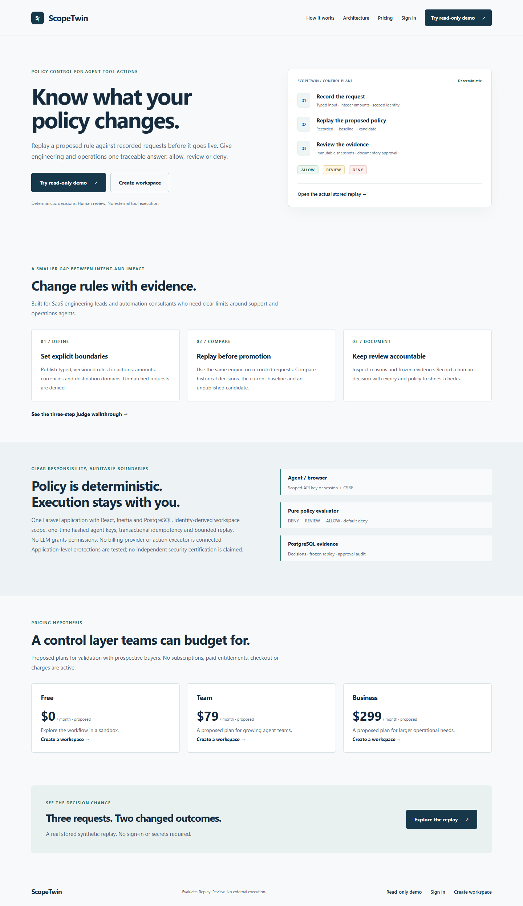
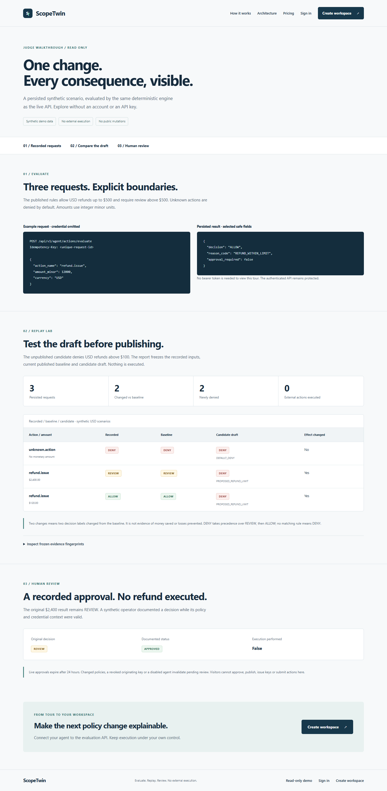
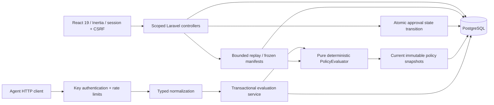

# ScopeTwin

**Know what your agent policy changes before it goes live.** Evaluate requests against explicit rules, replay a draft over recorded history, and document human review with a versioned audit trail.



Live hackathon demo: **[Open ScopeTwin](https://scopetwin-hizmali.onrender.com)** · **[Account-free judge tour](https://scopetwin-hizmali.onrender.com/demo)** · **[Replay comparison](https://scopetwin-hizmali.onrender.com/demo/replay)**. Public source: [HIZMALI/ScopeTwin](https://github.com/HIZMALI/ScopeTwin). The demo uses a fresh, isolated Render PostgreSQL database containing only synthetic data. Free hosting can sleep after 15 minutes; its first response can take about a minute. The free database expires on **November 19, 2026**; this is a time-limited hackathon preview, without a production availability or backup guarantee.

**ScopeTwin never issues refunds, executes tools, or transfers money.** The optional Backboard AI Replay Advisor is **disabled** in the public demo; no successful live LLM generation is claimed. Approval records a human decision only; it does not grant an execution token or change an original REVIEW result. Proposed pricing has no checkout or charges.

Release entry points: [technical evidence](docs/BUILD03_TECHNICAL_NOTES.md), [deployment](docs/DEPLOYMENT.md), [operations runbook](docs/OPERATIONS_RUNBOOK.md), [judge walkthrough](docs/DEMO_WALKTHROUGH.md), [go-live gates](docs/GO_LIVE_CHECKLIST.md), [Devpost draft](docs/DEVPOST_SUBMISSION.md), [video storyboard](docs/DEMO_VIDEO_SCRIPT.md). Build 02's detailed domain design remains in [its technical notes](docs/BUILD02_TECHNICAL_NOTES.md).

## Account-free judge tour

```powershell
./scripts/rehearse-production.ps1
```

For local rehearsal, open [the isolated local demo](http://127.0.0.1:18733/demo). For judges, use the [live public tour](https://scopetwin-hizmali.onrender.com/demo). It reads **persisted synthetic artifacts** created by the real evaluation/replay/approval services in a new disposable PostgreSQL service/database. It has no account requirement, raw token or write controls. Three stored requests show ALLOW/REVIEW/DENY; a frozen candidate produces **2 changed / 2 newly denied**, and an APPROVED documentary review preserves the original REVIEW. Changed labels are not claimed as financial savings.



The script preserves `.env`, APP_KEY, the original database and ports 18731/55439. New secrets stay in ignored `storage/.env.rehearsal`; the app binds loopback 18733. The default development app's `/demo` shows an honest unavailable state. Never seed `scopetwin`; demo setup requires explicit flags, disposable DB naming and an empty first installation. See [deployment safeguards](docs/DEPLOYMENT.md).

## Local setup (Windows PowerShell 7)

Requirements: PHP 8.3+ with PDO PostgreSQL/SQLite, Composer 2, Node 22+ with npm, and Docker Desktop. Verified here with PHP 8.4.24, Laravel 13.37.0, Node 24.13.1, PostgreSQL 18, React 19, Inertia 2, Tailwind 4 and shadcn/ui. Bootstrapped from the official `laravel/react-starter-kit` v1.0.1 and upgraded its framework/Tinker dependencies to Laravel 13; both lockfiles are committed.

```powershell
./scripts/setup.ps1
php artisan serve --host=127.0.0.1 --port=18731 --no-reload
```

Open [the local app](http://127.0.0.1:18731/register) and register your own account. There is no shared demo password. Setup generates a random local database password in ignored `.env`, preserves an existing application key, starts only this project's PostgreSQL service on `127.0.0.1:55439`, migrates, installs dependencies and builds assets. Port 8000 was unavailable on the implementation host, so the documented local port is 18731. No other project's containers are modified.

For manual setup: copy `.env.example` to `.env`, set a random `DB_PASSWORD`, run `composer install`, `php artisan key:generate`, `docker compose up -d --wait`, `php artisan migrate`, `npm ci`, `npm run build`, then start the server above. Do not regenerate `APP_KEY` on an existing installation: it invalidates agent key hashes and sessions.

The database queue is configured but no worker is needed for synchronous evaluations. Password recovery is honestly unavailable until an actual delivery transport and `PASSWORD_RECOVERY_ENABLED=true` are configured. Array/log mailers never count as delivery. The public preview uses the same production Dockerfile with a new remote APP_KEY and a separate runtime database role. Local environments are independent. Email delivery and password recovery are disabled on the public preview.

For an existing Build 01 installation, keep `.env` and run `php artisan migrate --no-interaction` followed by `npm run build`. Build 02's additive migration creates only `replay_runs`, `replay_results`, and `approval_requests`; it does not reset data or backfill historical REVIEW decisions.

## Five-minute workflow

1. Register / log in. Registration atomically provisions a workspace with OWNER membership.
2. Open **Agents**, create `Support Agent`, and save the key shown once. Leaving or refreshing the page discards the displayed key. Agent detail allows issuing additional keys, revoking keys, renaming, and disabling an agent. Disabling revokes every key and preserves history.
3. Open **Policies**, create and save a draft, then **Publish saved draft**. For an allow-refund rule choose `action_name equals refund.issue`, `amount_minor at most 50000`, `currency equals USD`, effect `ALLOW`, and reason `REFUND_WITHIN_LIMIT`.
4. Add a `REVIEW` rule for `refund.issue`, amount `greater than 50000`, currency `USD`, reason `REFUND_REQUIRES_APPROVAL`. Add an `ALLOW` rule for `customer.read` if desired.
5. Send the API request below. Overview and Decisions show the actual stored records, counts, reasons, agent, time and immutable policy snapshot. Decisions supports exact action / effect filters and 15-record pagination.
6. Save a new unpublished DENY draft for USD refunds greater than `10000`. Click **Preview impact**. Replay Lab freezes current published rules and the draft, compares recorded requests, and shows original / baseline / candidate decisions. Default sample is 100; maximum is 500. No draft is published by replay.
7. A new live REVIEW result creates one 24-hour **Pending** approval. Open **Approvals**, confirm Approve or Reject as an OWNER/ADMIN, and inspect its audit status. Policy changes, expiry, originating-key revocation or agent disablement block approval. Historical Build 01 REVIEW rows are read-only under **Historical reviews** and require fresh evaluation.
8. **Usage & Plans** displays actual counts for the last 30 UTC days and explicitly proposed Free / $79 Team / $299 Business pricing; billing is not live.

Alternatively, explicitly install all four development sample policies into an existing workspace. The workspace ID is available in the initial Inertia page props or via the following local command (which prints IDs only):

```powershell
php artisan tinker --execute='dump(App\Models\Organization::query()->get(["id", "name"])->toArray());'
php artisan scope:demo-policies --organization=<workspace-uuid>
```

The command is restricted to `local` / `testing`, is idempotent, and creates no accounts, tokens or traffic. Standard database seeding creates no fixtures at all. Sample export rules explicitly deny `data.export` to `blocked.example` and `untrusted.example`; every other export is denied by default until an explicit allow policy exists. These are reserved example domains, not real customer data.

## Actual HTTP API

`POST /api/v1/agent/actions/evaluate`

Headers: `Authorization: Bearer <one-time-key>`, `Content-Type: application/json`, `Accept: application/json`, and `Idempotency-Key: <unique-request-id>`.

To avoid placing a token in PowerShell history:

```powershell
./scripts/demo-api.ps1
```

The script securely prompts for the key and submits:

```json
{"action_name":"refund.issue","amount_minor":12000,"currency":"USD","resource_type":"refund"}
```

POSIX shell equivalent (read the key into an environment variable first; do not paste it into source control):

```sh
read -r -s SCOPETWIN_TOKEN
export SCOPETWIN_TOKEN
curl --request POST http://127.0.0.1:18731/api/v1/agent/actions/evaluate \
  --header "Authorization: Bearer $SCOPETWIN_TOKEN" \
  --header 'Content-Type: application/json' \
  --header 'Accept: application/json' \
  --header 'Idempotency-Key: refund-demo-001' \
  --data '{"action_name":"refund.issue","amount_minor":12000,"currency":"USD","resource_type":"refund"}'
unset SCOPETWIN_TOKEN
```

Measured HTTP 200 response from the browser/API verification run for the $120 refund (identifiers will differ in your workspace):

```json
{
  "decision_id": "01a14f93-fc13-73b0-ba06-949efcabdcc3",
  "decision": "ALLOW",
  "reason_code": "REFUND_WITHIN_LIMIT",
  "matched_policy_version_id": "01a14f93-ed1b-7131-811f-2340854bf498",
  "approval_required": false
}
```

The same live run returned `REVIEW / REFUND_REQUIRES_APPROVAL / approval_required: true` for `amount_minor: 240000` and `DENY / DEFAULT_DENY / matched_policy_version_id: null` for `unknown.action`. The first successful request stores one action, decision and audit event in a transaction. The same key and normalized input return the saved response, even after policy publication changes. Reuse with different input returns HTTP 409. Idempotency is scoped to organization + agent, not the individual API key.

Build 02 preserves that evaluation response exactly. New REVIEW decisions additionally store a PENDING approval and `approval.requested` audit in the same transaction; retries create no duplicate. Agents may read their own decision's status with the same bearer authentication:

```http
GET /api/v1/agent/decisions/<decision-uuid>/approval
Authorization: Bearer <your-one-time-key>
Accept: application/json
```

The response contains `decision_id`, nullable `approval_id`, `status`, nullable `expires_at` / `resolved_at`, and always `execution_performed: false`. Status is PENDING / APPROVED / REJECTED / STALE / EXPIRED; a pre-Build-02 REVIEW without a manifest returns REEVALUATION_REQUIRED, and a non-REVIEW decision returns NOT_REQUIRED. Another agent's decision returns 404, even within the same organization. GET is read-only and shares the agent rate limits.

| Status | Meaning |
| --- | --- |
| 200 | Evaluation succeeded, including business DENY |
| 401 | Missing, invalid, revoked key or disabled agent |
| 409 | Conflicting idempotency payload |
| 422 | Invalid payload or missing/invalid Idempotency-Key; JSON `message` and field-keyed `errors` |
| 429 | Rate limit exceeded; JSON message and retry headers |

Keys use a 16-hex random lookup prefix and 256-bit random secret. Only prefix + HMAC-SHA-256 using `APP_KEY` are stored. Issuance returns `Cache-Control: no-store, private` JSON directly; raw keys never enter session flash data or Inertia props. Browser code holds the key only in component memory. Audit metadata contains decision/reason/version identifiers, not keys or free-text input.

## Input and policy rules

The request must be a JSON object up to 8 KiB. Unknown fields, including tenant IDs, are rejected. `action_name` is required, lowercase, up to 128 characters; syntactically valid unknown actions receive default deny. Optional fields: `resource_type` (64), integer `amount_minor` (0–100000000000), supported uppercase ISO `currency`, DNS-like `destination_domain`, and `resource_label` (80 bytes). Amount requires currency. JSON floats and numeric strings are rejected. Domains are lowercased. Free-text resource labels are discarded before evaluation/storage to avoid recording PII; changing only a label does not change normalized identity. Do not send personal data in other fields or idempotency keys.

Supported currencies are explicitly listed in `app/Domain/ActionSchema.php` and the policy form (27 codes); USD is cents. The UI formats amounts using the currency's standard minor-unit precision. Inputs and comparisons remain integers throughout the backend.

```json
{
  "action_name": {"eq": "refund.issue"},
  "amount_minor": {"lte": 50000},
  "currency": {"eq": "USD"}
}
```

Conditions are AND, require an action-name condition, and allow one comparator per field. Strings support `eq` / `in`; amount also supports `gt` / `gte` / `lt` / `lte`. An `in` list has 1–20 typed values. No arbitrary expressions, SQL, tenant regex, JavaScript or LLM authorization is accepted.

Only the current published snapshot of an ACTIVE policy is considered. Matching **DENY > REVIEW > ALLOW**; no match means `DEFAULT_DENY`. Equal-effect matches use policy ID / version ordering. Saving an edit creates/updates a draft; publishing locks the policy and atomically switches its pointer. Earlier published snapshots are preserved and model-protected from mutation/deletion. Disabling a policy preserves snapshots and decisions.

## Architecture and schema



One repository and one application; Vite builds assets served by Laravel. PostgreSQL holds organizations, organization_memberships, agents, agent_api_keys, policies, policy_versions, action_requests, policy_decisions, audit_events, replay_runs, replay_results and approval_requests. Domain IDs are UUIDs; starter user IDs remain integers. Foreign keys, organization/time indexes, unique membership/version indexes, a unique organization-agent-idempotency index and unique approval-per-decision / result-per-run-request constraints protect persistence.

Browser context comes from the authenticated user's first membership; agent context comes from the verified key. OWNER / ADMIN can manage controls; VIEWER can read. Every resource lookup includes organization scope, including explicit UUID, key-revocation and audit endpoints. There is no organization switcher or invitation flow in Build 01. The application uses explicit scoped queries, not database row-level security.

Per-agent row locks serialize evaluation / key revocation / approval resolution and avoid duplicate races. Organization policy locks coordinate snapshot capture with publication and status changes. The agent and key are checked again inside the transaction. Only one approval terminal transition can succeed; a subsequent mutation returns 409. Rate limits are 60 requests/minute/agent and 180 requests/minute/IP at ingress. Replay creation is limited to 5/minute/user and 10/minute/organization; approval mutation to 30/minute/user/IP. Database cache is used locally. This intentionally trades write throughput for straightforward correctness boundaries.

## Verification

```powershell
php artisan test
npm run types:check
npm run build
npm run lint:check
composer audit
npm audit
./scripts/test-postgres.ps1
```

The standard suite uses isolated in-memory SQLite. `test-postgres.ps1` uses only the disposable `scopetwin_test` database, runs the same suite, rolls back/reapplies both domain migrations, and verifies original idempotency, concurrent REVIEW retries, approve/reject competition, and concurrent policy-change invalidation against real PostgreSQL locks. It does not touch application data.

For browser tests, keep Docker PostgreSQL running, then:

```powershell
npx playwright install chromium
npm run test:browser
```

Playwright creates/migrates the separate `scopetwin_browser_test` database and owns a server at port 18732; it leaves port 18731 untouched. The original three Chromium specs cover Build 01 regression, Replay Lab and Approvals over real HTTP/PostgreSQL; BUILD 03.5 adds a fourth Advisor UI scenario. Desktop/mobile assertions and real CSRF rejection remain. Synthetic passwords and API keys stay in test-process memory. Traces and automatic failure screenshots are disabled around secrets; explicit screenshots are captured only after hiding the issued key in ignored `storage/screenshots/`.

Measured counts and command outcomes are maintained in [docs/IMPLEMENTATION_LOG.md](docs/IMPLEMENTATION_LOG.md). Local test success is not a security audit or production certification.

## Security and release verification

The public tour uses separate stateless React pages, fixed demo workspace scope, capped safe-field projections and no GET writes, cookies or public mutation endpoints. Private flows retain role/tenant authorization, normal CSRF and agent-key authentication. Registration and recovery are limited to 5/minute/IP; untrusted forwarded headers do not select another rate-limit identity. Production trusts only the configured APP_URL host and explicitly configured proxy addresses.

Responses use private/no-store, framing denial, content-type protection and a CSP with per-request script nonces. Style inline allowances support actual React components; scripts do not allow unsafe-inline. HSTS is opt-in and only on secure production requests. Session defaults are Secure in production, HttpOnly and SameSite=Lax; only the isolated loopback HTTP rehearsal opts out of Secure. Production logging strips exception text/SQL bindings and sensitive contexts. `/up` is liveness, `/ready` checks migrated DB-backed infrastructure without exposing diagnostics.

```powershell
php artisan test --compact
./scripts/test-postgres.ps1
npm run test:browser
./scripts/rehearse-production.ps1
npm run test:release
./scripts/scan-containers.ps1
./scripts/test-database-image.ps1
node scripts/security-smoke.mjs
node scripts/load-smoke.mjs
./scripts/restore-smoke.ps1
npm run types:check
npm run build
npm run lint:check
npm run format:check
vendor/bin/pint --test
composer validate --strict
composer audit
npm audit
./scripts/check-secrets.ps1
php scripts/verify-preservation.php verify build03
```

The preservation guard is for this implementation host's ignored baseline, not a portable fixture. New installations may capture their own baseline explicitly. All PostgreSQL regression rollbacks remain confined to `scopetwin_test`; browser regressions own 18732 / `scopetwin_browser_test`. Release tests use built assets and a different PostgreSQL service at 18733. Full actual counts, timestamps, container scan exceptions and noncoverage are maintained in the [release evidence](docs/BUILD03_TECHNICAL_NOTES.md). GitHub-hosted Ubuntu CI runs against public main. The live HTTPS browser suite is opt-in (`PRODUCTION_TEST_URL=https://scopetwin-hizmali.onrender.com npx playwright test --config=playwright.production.config.ts`) and creates separate synthetic remote workspaces; it never uses local fixture databases. See the current [public release report](docs/PUBLIC_RELEASE_REPORT.md) for actual results and remaining limits.

## Component ownership

| Component | Source / responsibility |
| --- | --- |
| Authorization / key boundary | `app/Services/OrganizationContext.php`, `AgentKeys.php`, `app/Http/Middleware/AuthenticateAgent.php` |
| Pure typed decisions | `app/Domain/ActionSchema.php`, `ConditionSchema.php`, `PolicyEvaluator.php` |
| Transactional live history | `app/Services/EvaluateAction.php`, `PolicySnapshots.php` |
| Frozen replay / review | `app/Services/ReplayService.php`, `ApprovalService.php`, scoped controllers/models |
| Public read-only projection | `routes/public.php`, `PublicDemoController.php`, `resources/js/public.tsx` |
| Authenticated React workspace | `resources/js/pages/scope/`, `resources/js/components/scope.tsx` |
| Production / security | `Dockerfile`, `compose.production.yaml`, `deploy/`, `SecurityHeaders.php`, `config/security.php` |

## Limits and next steps

- Replay is synchronous and capped at 500 historical requests; each policy manifest is capped at 1 MiB. It measures decision-effect changes, not unverified false-positive/false-negative rates. Candidate drafts are frozen and explicitly marked as drafts, never fabricated published versions.
- Invalid pending approvals are displayed as EXPIRED/STALE on read without writes; a resolution attempt persists the terminal invalid state and returns 409. No cron is required to block them. Start a fresh evaluation with a new idempotency key when policy, time or credential context is invalid.
- No external refund connector, payment gateway or usage billing. The public GitHub repository and isolated HTTPS demo are published; commercial production durability is outside this free preview. No action executor exists. The optional Backboard explanation adapter is disabled: the separately authorized live attempts did not produce an accepted explanation; thread cleanup was confirmed. The latest returned upstream HTTP200/statusFAILED, and this account has no paid LLM credit. See [current diagnosis](docs/BACKBOARD_FIX_REPORT.md).
- Application-level scope and snapshot checks are not a substitute for operational controls over direct database access. Immutable snapshots are enforced by application code; no database immutability trigger is installed.
- BUILD 03 adds Chromium/Firefox/WebKit production-mode journeys and axe checks. Windows WebKit link Tab traversal is a documented runtime limitation; programmatic skip focus and dialog behavior are checked there, with actual link Tab traversal in Chromium/Firefox. This is not an accessibility certification or independent security audit.
- Hypothetical pricing, not validated or charged: Free sandbox; Team $79/month; Business $299/month. The usage/pricing UI is implemented; paid entitlements, quotas, billing and subscriptions are not.

## Optional AI Replay Advisor (BUILD 03.5)

OWNER/ADMIN users may explicitly request an English interpretation of frozen replay aggregates. The advisor cannot decide, change policies or execute actions. Server-enforced initial limits are three generation attempts/workspace/UTC day and one/user/rolling minute, with shared caching. Disabled/error states retain deterministic results. The public judge tour never calls Backboard.

Private server variable names: `BACKBOARD_ENABLED`, `BACKBOARD_API_KEY`, `BACKBOARD_ASSISTANT_ID`, `BACKBOARD_LLM_PROVIDER`, `BACKBOARD_MODEL_NAME`, `BACKBOARD_TIMEOUT_SECONDS`, `BACKBOARD_DAILY_CALLS`, `BACKBOARD_USER_CALLS_PER_MINUTE`, `BACKBOARD_CACHE_SECONDS`. BUILD 03.6 requires a valid explicit dedicated assistant UUID; missing/malformed binding makes zero upstream calls. Source defaults remain empty. Isolated18734 uses a dedicated assistant and `featherless` / `openai/gpt-oss-20b`, with **BACKBOARD_ENABLED=false**. **Two separately authorized single attempts on2026-10-20 did not yield an accepted explanation; cleanup was confirmed.** The latest UI attempt returned upstream HTTP200/statusFAILED before output validation. Read-only billing and the owner dashboard show a free memory/RAG-only credit scope with no paid LLM credit. The owner chose a video without an AI scene; no automatic retries or credit purchases were made. See [urgent fix evidence](docs/BACKBOARD_FIX_REPORT.md). Actual cost and sponsor eligibility are unverified. Read [privacy, cleanup and spending procedure](docs/BACKBOARD_INTEGRATION.md) and [submission delivery evidence](docs/SUBMISSION_DELIVERY_REPORT.md). The video makes no successful AI claim. Thread deletion does not prove deletion of provider logs.

For a separate production rehearsal run `./scripts/rehearse-production.ps1 -Build035`, then set `RELEASE_TEST_URL` to `http://127.0.0.1:18734` for release/security/load tests. Separate images/volumes/project preserve BUILD 03 on 18733. Scan with `./scripts/scan-containers.ps1 -Build build035`. Full evidence: [BUILD 03.5 report](docs/BUILD03_5_BACKBOARD_REPORT.md).

## License and provenance

Original ScopeTwin contributions use [MIT](LICENSE), consistent with the existing Composer license declaration. The official Laravel React starter supplied the starting framework/authentication UI; all third-party code retains its upstream notices. See [third-party/provenance notes](docs/THIRD_PARTY_NOTICES.md). No paid artwork, proprietary template, real customer dataset, compliance certification or organizer endorsement is claimed. The owner explicitly authorized the public GitHub repository and free Render preview. No custom DNS, payment service, video upload or Devpost submission is performed by the application.

## Verified local submission video — 2026-10-20

The revised real-browser demo removes the old Backboard failure narration and includes no fabricated AI success. It is `artifacts/submission-20261020/ScopeTwin-demo-1080p.mp4`: 3:50, 1920×1080, H.264 at 30 FPS, AAC stereo, English offline narration and burned synchronized English captions. The artifact directory is intentionally Git-ignored; video delivery is separate from source publication. The owner will upload the video and submit Devpost. No public video URL is claimed. See [capture and reproduction](docs/DEMO_VIDEO_SCRIPT.md) and [actual verification results](docs/SUBMISSION_DELIVERY_REPORT.md).
