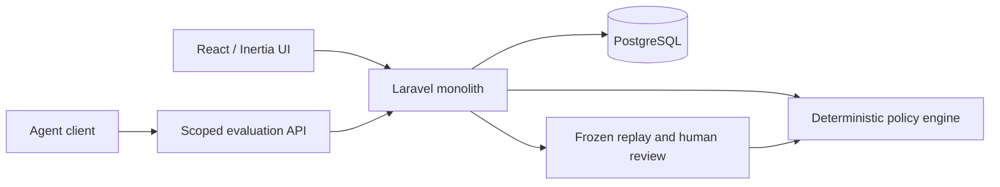

# ScopeTwin

ScopeTwin helps teams review policy changes before applying them to agent requests. It evaluates typed requests against versioned rules, compares proposed policies with recorded history, and records human review with an audit trail.

[Website](https://scopetwin-hizmali.onrender.com) · [Read-only demo](https://scopetwin-hizmali.onrender.com/demo) · [Replay Lab](https://scopetwin-hizmali.onrender.com/demo/replay) · [Video](https://youtu.be/6cyv4wC1CR4) · [GitHub](https://github.com/HIZMALI/ScopeTwin)


## Features

- **Deterministic evaluation:** ALLOW, REVIEW or DENY, with default deny and precedence `DENY > REVIEW > ALLOW`.
- **Versioned policies:** edit drafts without affecting live requests; publish a validated snapshot when ready.
- **Replay Lab:** compare Original, Baseline and Candidate outcomes using frozen inputs and policy definitions.
- **Human review:** record approval or rejection with expiry and policy/credential freshness checks. The original REVIEW remains unchanged.
- **Workspace isolation:** scoped agent credentials, role-based browser access and authenticated decision/audit records.
- **Usage & Plans:** counts from workspace records; proposed pricing with no checkout or payment processing.

The public demo uses persisted synthetic data: three requests, **2 changed / 2 newly denied** in the candidate replay, and a documentary approval. ScopeTwin does not execute refunds, transfer money or run external tools. Backboard AI Advisor is **disabled in production**; successful live LLM advice is not claimed.

## Technology and architecture

Laravel 13, PHP 8.3+ (production image: PHP 8.4), React 19, Inertia 2, TypeScript, Tailwind 4, shadcn/ui and PostgreSQL 18. Composer and npm lockfiles pin dependencies. A single Docker image serves the backend and built frontend through FrankenPHP/Caddy.



The browser uses session authentication and CSRF protection. Agent requests use revocable, workspace-scoped bearer credentials. Replay uses the same evaluator and creates no executable action. The optional AI adapter is outside the authorization path. See [architecture and data model](docs/ARCHITECTURE.md).

## Local installation

Requirements: PHP 8.3+ with PDO PostgreSQL/SQLite, Composer 2, Node.js 22+ with npm, Docker Desktop and PowerShell 7. The recorded development baseline used PHP 8.4.24 and PostgreSQL 18.

For a **new local installation**, clone the repository and run:

```powershell
git clone https://github.com/HIZMALI/ScopeTwin.git
cd ScopeTwin
./scripts/setup.ps1
php artisan serve --host=127.0.0.1 --port=18731 --no-reload
```

Open [localhost:18731](http://127.0.0.1:18731) and register your own workspace. There is no shared demo password. Setup installs dependencies, creates a private `.env` if absent, fills missing application/database keys, starts this project's PostgreSQL on loopback port 55439, runs migrations and builds frontend assets. Check port availability first.

For an existing installation, back up its database and private configuration before any upgrade. Preserve `APP_KEY` and database credentials; changing the key invalidates existing agent credential hashes. Review [deployment](docs/DEPLOYMENT.md) and [operations](docs/OPERATIONS_RUNBOOK.md) for controlled migrations, backups and rollback.

To use an existing PostgreSQL server instead, privately configure a new `.env` from [the example](.env.example), install Composer dependencies, generate a key **only for a new installation**, run forward migrations, then `npm ci` and `npm run build`. Never commit the private file. Session/cache storage uses the database; the synchronous workflows need no queue worker or scheduler.

The account-free local tour is a separate, opt-in installation. See [isolated rehearsal instructions](docs/DEPLOYMENT.md#reproduce-the-isolated-local-rehearsal-powershell-7); do not seed an existing user database.

## API usage

Create an agent in your authenticated workspace, save its one-time key privately, and publish policies. Without a matching published rule the API returns DENY. Monetary values are integer minor units: `12000` is USD 120.00.

```sh
# Supply SCOPETWIN_AGENT_TOKEN privately in your shell; never paste it into Git.

curl --request POST http://127.0.0.1:18731/api/v1/agent/actions/evaluate \
  --header "Authorization: Bearer $SCOPETWIN_AGENT_TOKEN" \
  --header 'Accept: application/json' \
  --header 'Content-Type: application/json' \
  --header 'Idempotency-Key: refund-example-001' \
  --data '{"action_name":"refund.issue","amount_minor":12000,"currency":"USD","resource_type":"refund"}'
```

An accepted evaluation returns HTTP 200 with `decision_id`, `decision`, `reason_code`, `matched_policy_version_id` and `approval_required`. The result depends on your published rules. Repeating the same key and normalized payload returns the saved decision; a different payload with that key returns 409. Authentication, validation and throttling use 401, 422 and 429 respectively.

PowerShell users can run [the API example script](scripts/demo-api.ps1), which prompts for a key without echoing it. See the [API reference](docs/API.md) for input bounds, response semantics and approval lookup.

## Security approach

- Organization context comes from authenticated membership or the agent credential, never a submitted tenant ID.
- Agent secrets are shown once and stored as keyed hashes. Requests have input bounds, rate limits and transactional idempotency.
- Published policy snapshots and replay reports are protected by application services; audit entries contain identifiers and safe metadata.
- Production uses debug-off operation, nonce CSP, HTTPS security headers, explicit host/proxy trust and a database runtime role without schema ownership or DDL privileges.
- The public tour exposes only bounded projections from a fixed synthetic workspace. It has no public mutation handlers, session cookies or AI calls.

These are tested application controls, not an independent security certification. Database administrators remain privileged. Deployment-specific proxy settings must be validated on their actual network path.

## Tests and verification

The verified application baseline is `20f9a7d`; documentation baseline `f5c6b0b` preserves that code. Recorded release checks on **21 October 2026** include:

| Check                                     | Actual recorded result                                                       |
| ----------------------------------------- | ---------------------------------------------------------------------------- |
| SQLite regression                         | 212 tests, 1,615 assertions passed                                           |
| GitHub Linux CI                           | Tests and linter passed                                                      |
| Live PostgreSQL-backed Chromium workflows | 3 scenarios passed, including API, replay, approvals and workspace isolation |
| Frontend / PHP checks                     | TypeScript, Vite build, ESLint, Prettier and Pint passed                     |
| Dependency advisories                     | Composer: 0; npm: 0 at the recorded check                                    |

The [testing guide](docs/TESTING.md) distinguishes release evidence from earlier PostgreSQL/concurrency runs and explains how to reproduce them safely. Those dates and counts do not imply every check was rerun for a documentation edit.

```powershell
php vendor/phpunit/phpunit/phpunit tests/Unit/PolicyEvaluatorTest.php
npm run types:check
npm run lint:check
composer validate --strict
```

The evaluator test above needs no database. Full suites, database tests and browser workflows require the isolated targets described in the guide.

## Known limitations

- Backboard advice is optional, disabled in production and not verified as a successful live integration. Core workflows do not require it. See [adapter boundaries](docs/BACKBOARD_INTEGRATION.md).
- Approvals are documentary; no external tool execution, payment gateway or active paid entitlements exist. The displayed $79/$299 plans are pricing hypotheses.
- Replay is synchronous, with a maximum of 500 requests and 1 MiB manifests. There is no automatic evidence-retention scheduler, organization-switching/invitation UI or PostgreSQL row-level security.
- Email delivery and password recovery are disabled in the public preview. No commercial SLA, compliance certification or capacity guarantee is claimed.
- The free Render preview may sleep after inactivity. Its PostgreSQL service is scheduled to expire on **19 November 2026**, has no managed backups/PITR, and requires an operator plan for continued availability. The web filesystem is ephemeral.

## Documentation

| Audience    | Documents                                                                                                                                                                                |
| ----------- | ---------------------------------------------------------------------------------------------------------------------------------------------------------------------------------------- |
| Developers  | [Architecture](docs/ARCHITECTURE.md), [API](docs/API.md), [acceptance contract](docs/ACCEPTANCE_TESTS.md), [testing](docs/TESTING.md)                                                    |
| Operators   | [Deployment](docs/DEPLOYMENT.md), [operations runbook](docs/OPERATIONS_RUNBOOK.md), [Backboard adapter](docs/BACKBOARD_INTEGRATION.md)                                                   |
| Reviewers   | [Demo walkthrough](docs/DEMO_WALKTHROUGH.md), [video guide](docs/DEMO_VIDEO_SCRIPT.md), [Devpost text](docs/DEVPOST_SUBMISSION.md), [submission checklist](docs/SUBMISSION_CHECKLIST.md) |
| Maintainers | [Contribution instructions](AGENTS.md), [maintenance record](docs/IMPLEMENTATION_LOG.md), [third-party notices](docs/THIRD_PARTY_NOTICES.md)                                             |

## License and provenance

[MIT](LICENSE) for original ScopeTwin contributions. The project began with the official Laravel React starter kit and was developed with AI-assisted coding tools. Framework, component and dependency authors retain their respective rights; see [third-party notices](docs/THIRD_PARTY_NOTICES.md).
