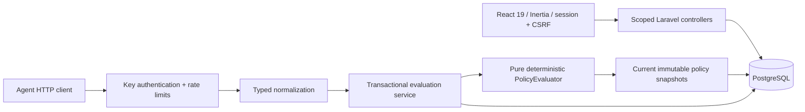

# ScopeTwin

Deterministic policy decisions for agent tool requests, with a versioned audit trail. Build 01 is a working Laravel monolith: registration, scoped organizations, agents, one-time API keys, policy drafts/publication, and recorded ALLOW / REVIEW / DENY decisions.

**This endpoint evaluates requests only. It does not issue refunds, execute tools, call an LLM, or transfer money.** Review results are recorded; an approval workflow and the Replay Lab UI belong to Build 02.

## Local setup (Windows PowerShell 7)

Requirements: PHP 8.3+ with PDO PostgreSQL/SQLite, Composer 2, Node 22+ with npm, and Docker Desktop. Verified here with PHP 8.4.24, Laravel 13.37.0, Node 24.13.1, PostgreSQL 18, React 19, Inertia 2, Tailwind 4 and shadcn/ui. Bootstrapped from the official `laravel/react-starter-kit` v1.0.1 and upgraded its framework/Tinker dependencies to Laravel 13; both lockfiles are committed.

```powershell
./scripts/setup.ps1
php artisan serve --host=127.0.0.1 --port=18731 --no-reload
```

Open [the local app](http://127.0.0.1:18731/register) and register your own account. There is no shared demo password. Setup generates a random local database password in ignored `.env`, preserves an existing application key, starts only this project's PostgreSQL service on `127.0.0.1:55439`, migrates, installs dependencies and builds assets. Port 8000 was unavailable on the implementation host, so the documented local port is 18731. No other project's containers are modified.

For manual setup: copy `.env.example` to `.env`, set a random `DB_PASSWORD`, run `composer install`, `php artisan key:generate`, `docker compose up -d --wait`, `php artisan migrate`, `npm ci`, `npm run build`, then start the server above. Do not regenerate `APP_KEY` on an existing installation: it invalidates agent key hashes and sessions.

The database queue is configured but no worker is needed for synchronous evaluations. `MAIL_MAILER=array` intentionally does not deliver or log reset emails. Configure a mail transport before using password recovery. No production deployment is included.

## Five-minute workflow

1. Register / log in. Registration atomically provisions a workspace with OWNER membership.
2. Open **Agents**, create `Support Agent`, and save the key shown once. Leaving or refreshing the page discards the displayed key. Agent detail allows issuing additional keys, revoking keys, renaming, and disabling an agent. Disabling revokes every key and preserves history.
3. Open **Policies**, create and save a draft, then **Publish saved draft**. For an allow-refund rule choose `action_name equals refund.issue`, `amount_minor at most 50000`, `currency equals USD`, effect `ALLOW`, and reason `REFUND_WITHIN_LIMIT`.
4. Add a `REVIEW` rule for `refund.issue`, amount `greater than 50000`, currency `USD`, reason `REFUND_REQUIRES_APPROVAL`. Add an `ALLOW` rule for `customer.read` if desired.
5. Send the API request below. Overview and Decisions show the actual stored records, counts, reasons, agent, time and immutable policy snapshot. Decisions supports exact action / effect filters and 15-record pagination.

Alternatively, explicitly install all four development sample policies into an existing workspace. The workspace ID is available in the initial Inertia page props or via the following local command (which prints IDs only):

```powershell
php artisan tinker --execute='dump(App\Models\Organization::query()->get(["id", "name"])->toArray());'
php artisan scope:demo-policies --organization=<workspace-uuid>
```

The command is restricted to `local` / `testing`, is idempotent, and creates no accounts, tokens or traffic. Standard database seeding creates no fixtures at all. Sample export rules explicitly deny `data.export` to `blocked.example` and `untrusted.example`; every other export is denied by default until an explicit allow policy exists. These are reserved example domains, not real customer data.

## Actual HTTP API

`POST /api/v1/agent/actions/evaluate`

Headers: `Authorization: Bearer <one-time-key>`, `Content-Type: application/json`, `Accept: application/json`, and `Idempotency-Key: <unique-request-id>`.

To avoid placing a token in PowerShell history:

```powershell
./scripts/demo-api.ps1
```

The script securely prompts for the key and submits:

```json
{"action_name":"refund.issue","amount_minor":12000,"currency":"USD","resource_type":"refund"}
```

POSIX shell equivalent (read the key into an environment variable first; do not paste it into source control):

```sh
read -r -s SCOPETWIN_TOKEN
export SCOPETWIN_TOKEN
curl --request POST http://127.0.0.1:18731/api/v1/agent/actions/evaluate \
  --header "Authorization: Bearer $SCOPETWIN_TOKEN" \
  --header 'Content-Type: application/json' \
  --header 'Accept: application/json' \
  --header 'Idempotency-Key: refund-demo-001' \
  --data '{"action_name":"refund.issue","amount_minor":12000,"currency":"USD","resource_type":"refund"}'
unset SCOPETWIN_TOKEN
```

Measured HTTP 200 response from the browser/API verification run for the $120 refund (identifiers will differ in your workspace):

```json
{
  "decision_id": "01a14f93-fc13-73b0-ba06-949efcabdcc3",
  "decision": "ALLOW",
  "reason_code": "REFUND_WITHIN_LIMIT",
  "matched_policy_version_id": "01a14f93-ed1b-7131-811f-2340854bf498",
  "approval_required": false
}
```

The same live run returned `REVIEW / REFUND_REQUIRES_APPROVAL / approval_required: true` for `amount_minor: 240000` and `DENY / DEFAULT_DENY / matched_policy_version_id: null` for `unknown.action`. The first successful request stores one action, decision and audit event in a transaction. The same key and normalized input return the saved response, even after policy publication changes. Reuse with different input returns HTTP 409. Idempotency is scoped to organization + agent, not the individual API key.

| Status | Meaning |
| --- | --- |
| 200 | Evaluation succeeded, including business DENY |
| 401 | Missing, invalid, revoked key or disabled agent |
| 409 | Conflicting idempotency payload |
| 422 | Invalid payload or missing/invalid Idempotency-Key; JSON `message` and field-keyed `errors` |
| 429 | Rate limit exceeded; JSON message and retry headers |

Keys use a 16-hex random lookup prefix and 256-bit random secret. Only prefix + HMAC-SHA-256 using `APP_KEY` are stored. Issuance returns `Cache-Control: no-store, private` JSON directly; raw keys never enter session flash data or Inertia props. Browser code holds the key only in component memory. Audit metadata contains decision/reason/version identifiers, not keys or free-text input.

## Input and policy rules

The request must be a JSON object up to 8 KiB. Unknown fields, including tenant IDs, are rejected. `action_name` is required, lowercase, up to 128 characters; syntactically valid unknown actions receive default deny. Optional fields: `resource_type` (64), integer `amount_minor` (0–100000000000), supported uppercase ISO `currency`, DNS-like `destination_domain`, and `resource_label` (80 bytes). Amount requires currency. JSON floats and numeric strings are rejected. Domains are lowercased. Free-text resource labels are discarded before evaluation/storage to avoid recording PII; changing only a label does not change normalized identity. Do not send personal data in other fields or idempotency keys.

Supported currencies are explicitly listed in `app/Domain/ActionSchema.php` and the policy form (27 codes); USD is cents. The UI formats amounts using the currency's standard minor-unit precision. Inputs and comparisons remain integers throughout the backend.

```json
{
  "action_name": {"eq": "refund.issue"},
  "amount_minor": {"lte": 50000},
  "currency": {"eq": "USD"}
}
```

Conditions are AND, require an action-name condition, and allow one comparator per field. Strings support `eq` / `in`; amount also supports `gt` / `gte` / `lt` / `lte`. An `in` list has 1–20 typed values. No arbitrary expressions, SQL, tenant regex, JavaScript or LLM authorization is accepted.

Only the current published snapshot of an ACTIVE policy is considered. Matching **DENY > REVIEW > ALLOW**; no match means `DEFAULT_DENY`. Equal-effect matches use policy ID / version ordering. Saving an edit creates/updates a draft; publishing locks the policy and atomically switches its pointer. Earlier published snapshots are preserved and model-protected from mutation/deletion. Disabling a policy preserves snapshots and decisions.

## Architecture and schema



One repository and one application; Vite builds assets served by Laravel. PostgreSQL holds organizations, organization_memberships, agents, agent_api_keys, policies, policy_versions, action_requests, policy_decisions and audit_events. Domain IDs are UUIDs; starter user IDs remain integers. Foreign keys, organization/time indexes, unique membership/version indexes and a unique organization-agent-idempotency index protect persistence.

Browser context comes from the authenticated user's first membership; agent context comes from the verified key. OWNER / ADMIN can manage controls; VIEWER can read. Every resource lookup includes organization scope, including explicit UUID, key-revocation and audit endpoints. There is no organization switcher or invitation flow in Build 01. The application uses explicit scoped queries, not database row-level security.

Per-agent row locks serialize evaluation / key revocation and avoid duplicate races. The agent and key are checked again inside the transaction. A single query loads active snapshot pointers. Rate limits are 60 requests/minute/agent and 180 requests/minute/IP at ingress, with database cache in local development. This intentionally trades per-agent write throughput for a straightforward correctness boundary.

## Verification

```powershell
php artisan test
npm run types:check
npm run build
npx eslint resources/js/pages/scope resources/js/components/scope.tsx resources/js/components/one-time-key.tsx
composer audit
npm audit
./scripts/test-postgres.ps1
```

The standard suite uses isolated in-memory SQLite. `test-postgres.ps1` uses only the disposable `scopetwin_test` database, runs the same suite, rolls back/reapplies the domain migration, and runs six simultaneous PHP worker requests through the persistence service to verify duplicate/conflict races against real PostgreSQL locks. It does not touch application data.

For the browser test, start the local server, then:

```powershell
npx playwright install chromium
npm run test:browser
```

The browser test registers a synthetic account with a generated password, logs out/in, creates an agent and three published rules, sends real HTTP requests, checks decisions/filters, checks mobile widths, revokes the key and logs out. It leaves synthetic history in the local workspace database; no reusable credentials are written to source or output. Browser traces and automatic screenshots are disabled around secrets. Explicit screenshots are captured only after hiding the issued key in ignored `storage/screenshots/`.

Measured counts and command outcomes are maintained in [docs/IMPLEMENTATION_LOG.md](docs/IMPLEMENTATION_LOG.md). Local test success is not a security audit or production certification.

## Limits and next build

- Build 02: Replay Lab with version comparison, authorized approval queue and replay result persistence; use the same pure evaluator. Snapshot re-evaluation is already covered by a no-network/no-write test, but no Replay Lab screen or replay API is claimed here.
- No external refund connector, Backboard/LLM integration, payment gateway, usage billing, production deployment or remote push. No action executor exists.
- Application-level scope and snapshot checks are not a substitute for operational controls over direct database access. Immutable snapshots are enforced by application code; no database immutability trigger is installed.
- Browser coverage is Chromium on this machine. No Firefox/WebKit or independent accessibility/security audit has been performed.
- Hypothetical pricing, not validated or charged: Free sandbox; Team $79/month; Business $299/month. Usage metering and pricing UI are future work.
